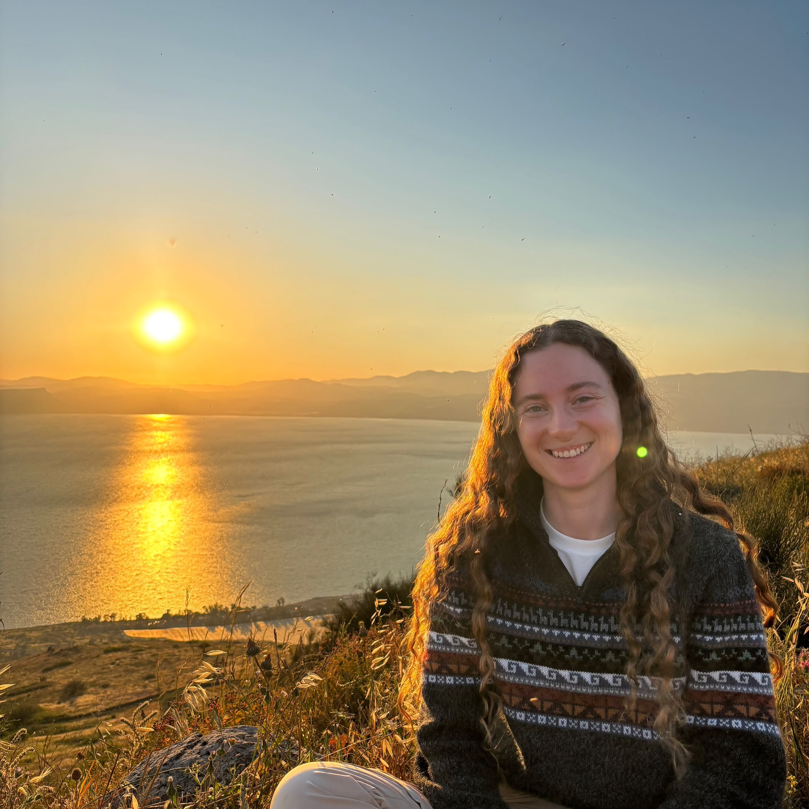
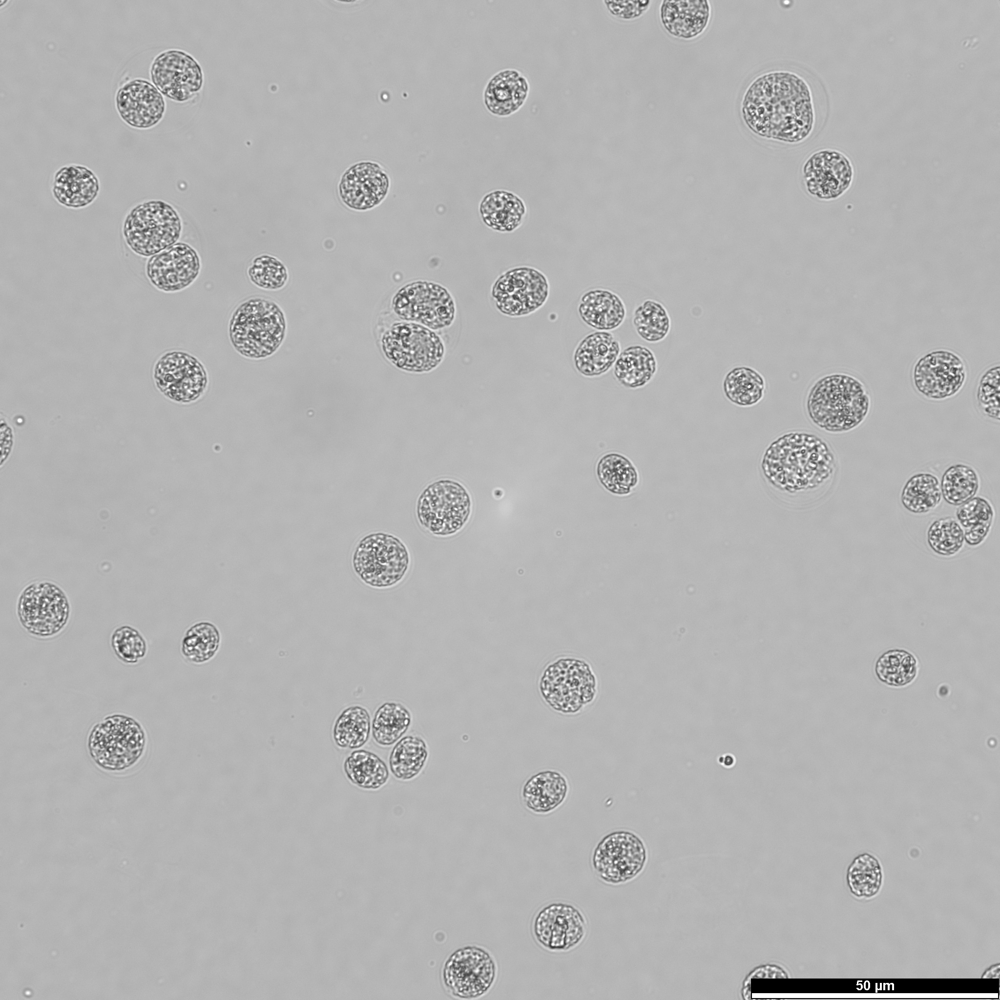
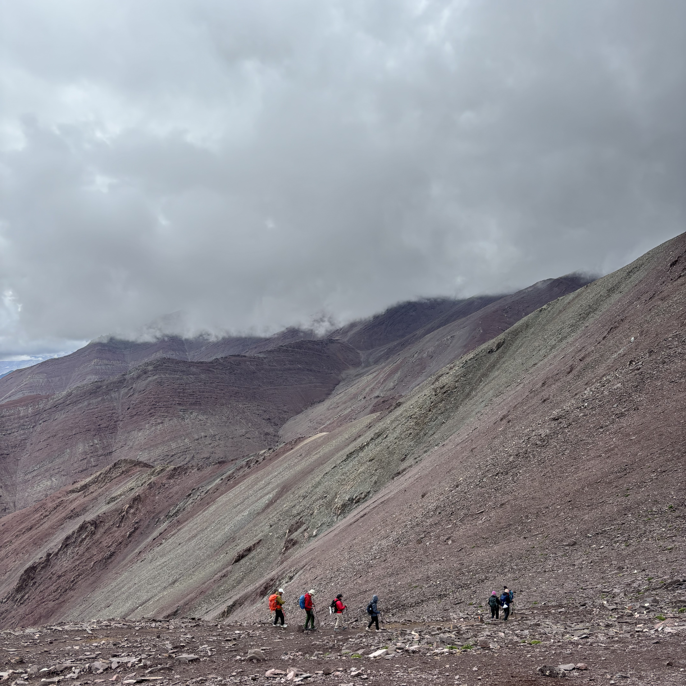

# Sari Radziner

### 👋 Nice to meet you 

My name is **Sari**, and I've just started my **MSc in Life Sciences** at the Weizmann Institute.

I completed my **BSc in Plant Sciences** at the Faculty of Agriculture, Hebrew University of Jerusalem.

### 🔬 What I'm working on

I'm currently doing my first rotation in [**Dr. Dvir Gur's lab**](https://www.weizmann.ac.il/molgen/gur/), where I'm exploring the dynamics of bio-crystals in *Chlamydomonas reinhardtii*, a cute unicellular alga 🟢:

### 🕓 In my free time

When I'm not in the lab, you'll probably find me hiking or reading a good book.

Here's a photo from my latest hiking adventure in northern India, taken at 5,300 meters above sea level, just before starting my MSc:

